# Mid-Project Jarkom Kelompok 10

## Alasan pemilihan skema: VLSM (bukan CIDR)

Skema utama **VLSM** dipilih karena spreadsheet kelompok mencatat hasil VLSM pada basis `10.80.0.0/16` dan prefix dapat ditentukan berdasarkan kebutuhan host. Spreadsheet juga memuat perbandingan CIDR UTS dan CIDR revisi. Catatan pada spreadsheet menyatakan CIDR revisi per-router memerlukan `10.80.0.0/15`, sehingga penerimaan blok tersebut perlu dikonfirmasi kepada dosen/asisten. Contoh kebutuhan yang tercatat: WiFi Utara 11.000 host, Kantor Pelabuhan 120 host, Puskesmas dan Sekolah Barat 220 host, dan WiFi Barat 4.500 host.

## Alasan desain per lokasi

- **Balai Kota (R-PUSAT)**: 2 LAN terpisah (Pegawai /21 dan Server /27) masing-masing satu switch 2960, langsung ke port routed G0/0–G0/1. R-PUSAT memakai 3× HWIC-2T karena 2911 hanya punya 3 port routed bawaan dan butuh 8 koneksi (2 switch LAN + 6 backbone).
- **Data Center (R-DC)**: CCTV Kota (PC perwakilan di SW-CCTV) dan Server&Storage (Server-PT untuk layanan DNS/FTP/DHCP sesuai desain) di dua switch terpisah.
- **Layanan publik (WiFi Utara/Selatan/Timur/Barat)**: AccessPoint-PT tersambung copper ke router, klien wireless (3 smartphone + 1 laptop) — mewakili akses publik kota.
- **Sensor**: Sensor Lalu Lintas Utara menggunakan subnet `/23`; Sensor Banjir Timur menggunakan `/22`, sesuai tabel VLSM.
- **Puskesmas & PJU**: PC perwakilan pada switch.
- **Pelabuhan**: SCADA (PC) dan Kantor (PC) pada dua switch; L6 ke R-UTARA ethernet, backbone ke PUSAT via serial transit R-UTARA.
- **Media backbone**: serial (HWIC-2T) untuk L1–L5 (port routed 2911 terbatas); PUSAT–ISP dan L6 ethernet; LAN memakai straight copper; klien wireless lewat AP.
- **Perwakilan 1 device/LAN** sesuai instruksi; perhitungan subnet tetap memakai jumlah host penuh.

## Soal 1 — Topologi

Screenshot topologi tersedia, tetapi status link dan kecocokan seluruh sambungan dengan Gambar 1 perlu diperiksa kembali secara langsung di Packet Tracer. Screenshot menunjukkan perangkat bernama deskriptif dan label LAN; label host perlu dicocokkan dengan tab `Label_Topologi` pada spreadsheet. Terlihat ketidaksesuaian: label WiFi Utara pada screenshot menunjukkan 9.500 host, sementara tabel VLSM mencatat 11.000; label WiFi Barat menunjukkan 8.190, sedangkan tabel mencatat kebutuhan 4.500. Jangan menganggap angka kapasitas subnet sama dengan jumlah host yang diminta.

- Semua perangkat bernama deskriptif (R-PUSAT, SW-BALAIKOTA, PC-CCTV-KOTA, dst).
- 14 label LAN pada kanvas format `nama | netid/prefix | jumlah host`.
- Backbone & hubungan antar-router (termasuk R-ISP dan server 8.8.8.8) sesuai Gambar 1.

**Rincian 41 perangkat:** 8 router 2911, 10 switch 2960-24TT, 4 Access Point, 3 server, 8 PC, 4 klien wireless (3 smartphone + 1 laptop), 4 Power Distribution Device (otomatis PT).

**Rincian 43 kabel:** 7 backbone router-router + 14 uplink LAN (10 switch + 4 AP) + 11 kabel host (8 PC + 3 server) + 4 asosiasi wireless + 7 kabel power PDU.

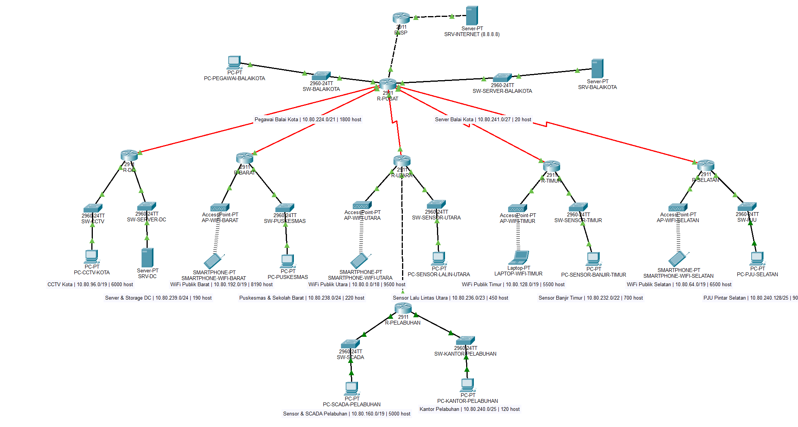

**Penjelasan**: screenshot kanvas logical Packet Tracer. Terlihat 8 router (nama deskriptif), 14 LAN dengan label `nama | Network ID/prefix | jumlah host`, 4 AP dengan klien wireless-nya, R-ISP yang menghubungkan R-PUSAT ke server internet 8.8.8.8, serta backbone serial (garis petir, L1–L5) dan ethernet (L6, PUSAT–ISP, LAN).

### Port map R-PUSAT (2911 + 3× HWIC-2T)
| Port | Arah | Peran |
|---|---|---|
| G0/0 | SW-BALAIKOTA | LAN Pegawai Balai Kota (10.80.224.1/21) |
| G0/1 | SW-SERVER-BALAIKOTA | LAN Server Balai Kota (10.80.241.1/27) |
| G0/2 | R-ISP | **ethernet straight** 203.0.113.42/30 (**outside NAT**) |
| S0/0/1 | R-UTARA | serial 10.80.241.37/30 (L2) |
| S0/2/0 | R-SELATAN | serial 10.80.241.41/30 (L3) |
| S0/2/1 | R-TIMUR | serial 10.80.241.45/30 (L4) |
| S0/3/0 | R-BARAT | serial 10.80.241.49/30 (L5) |
| S0/3/1 | R-DC | serial 10.80.241.33/30 (L1) |

Sisi DCE semua serial ada di R-PUSAT, `clock rate 2000000`.

### Port map R-UTARA
S0/0/0 → R-PUSAT (10.80.241.38/30); G0/0 → AP WiFi Utara (10.80.0.1/18); G0/1 → R-PELABUHAN (10.80.241.53/30, L6); G0/2 → SW-SENSOR-UTARA (10.80.236.1/23).

Router lain: R-DC S0/0/0 = backbone ke R-PUSAT, G0/1 & G0/2 = LAN-nya; SELATAN/TIMUR/BARAT sama pola (S0/0/0 backbone). R-ISP: G0/0 = 203.0.113.41/30 (straight ke PUSAT), G0/1 = 8.8.8.1/24.


## Soal 3 — Pengalamatan + Static/Default Routing

Skema utama **VLSM** (hasil UTS), gateway = host pertama tiap subnet. Setiap LAN satu subnet, gateway di port routed router.

### Tabel pengalamatan
| Lokasi | Subnet | Gateway (IP router) |
|---|---|---|
| WiFi Utara | 10.80.0.0/18 | 10.80.0.1 (R-UTARA G0/0) |
| WiFi Selatan | 10.80.64.0/19 | 10.80.64.1 (R-SELATAN G0/1) |
| CCTV Kota | 10.80.96.0/19 | 10.80.96.1 (R-DC G0/1) |
| WiFi Timur | 10.80.128.0/19 | 10.80.128.1 (R-TIMUR G0/1) |
| SCADA Pelabuhan | 10.80.160.0/19 | 10.80.160.1 (R-PELABUHAN G0/1) |
| WiFi Barat | 10.80.192.0/19 | 10.80.192.1 (R-BARAT G0/1) |
| Pegawai Balai Kota | 10.80.224.0/21 | 10.80.224.1 (R-PUSAT G0/0) |
| Sensor Banjir Timur | 10.80.232.0/22 | 10.80.232.1 (R-TIMUR G0/2) |
| Sensor Lalin Utara | 10.80.236.0/23 | 10.80.236.1 (R-UTARA G0/2) |
| Puskesmas | 10.80.238.0/24 | 10.80.238.1 (R-BARAT G0/2) |
| Server DC | 10.80.239.0/24 | 10.80.239.1 (R-DC G0/2) |
| Kantor Pelabuhan | 10.80.240.0/25 | 10.80.240.1 (R-PELABUHAN G0/2) |
| PJU Selatan | 10.80.240.128/25 | 10.80.240.129 (R-SELATAN G0/2) |
| Server Balai Kota | 10.80.241.0/27 | 10.80.241.1 (R-PUSAT G0/1) |

### Link /30
| Link | Subnet | Media | Ujung A | Ujung B |
|---|---|---|---|---|
| L1 PUSAT–DC | 10.80.241.32/30 | serial | .33 | .34 |
| L2 PUSAT–UTARA | 10.80.241.36/30 | serial | .37 | .38 |
| L3 PUSAT–SELATAN | 10.80.241.40/30 | serial | .41 | .42 |
| L4 PUSAT–TIMUR | 10.80.241.44/30 | serial | .45 | .46 |
| L5 PUSAT–BARAT | 10.80.241.48/30 | serial | .49 | .50 |
| L6 UTARA–PELABUHAN | 10.80.241.52/30 | ethernet | .53 | .54 |
| PUSAT–ISP | 203.0.113.40/30 | straight | .42 (PUSAT) | .41 (ISP) |
| ISP–Internet | 8.8.8.0/24 | ethernet | .1 (ISP G0/1) | .8.8.8 (server) |

Server statis: SRV-BALAIKOTA 10.80.241.2/27, SRV-DC 10.80.239.2/24, SRV-INTERNET 8.8.8.8/24 (gw 8.8.8.1).

### Rute statis
- **Default route yang disyaratkan:** R-DC menuju R-PUSAT, R-PELABUHAN menuju R-UTARA, dan R-PUSAT menuju R-ISP. README versi sebelumnya menyatakan semua router cabang default ke R-PUSAT, sehingga pernyataan itu bertentangan dengan brief untuk R-PELABUHAN. Konfigurasi R-PELABUHAN belum diverifikasi dari file Packet Tracer; jangan anggap ketentuan ini telah terpenuhi sebelum memeriksa tabel rute di Packet Tracer.
- **R-PUSAT**: konfigurasi dan screenshot yang didokumentasikan menunjukkan default ke R-ISP serta static route ke jaringan cabang.
- **R-UTARA**: dokumentasi/screenshot menunjukkan static route menuju LAN SCADA dan Kantor Pelabuhan melalui R-PELABUHAN.
- **R-ISP**: screenshot tabel rute yang tersedia hanya menunjukkan jaringan connected, tanpa rute privat yang terlihat. Ini adalah bukti dari snapshot, bukan verifikasi kondisi file saat ini.

```cisco
R-PUSAT
ip route 0.0.0.0 0.0.0.0 203.0.113.41
ip route 10.80.96.0 255.255.224.0 10.80.241.34
ip route 10.80.239.0 255.255.255.0 10.80.241.34
ip route 10.80.0.0 255.255.192.0 10.80.241.38
ip route 10.80.236.0 255.255.254.0 10.80.241.38
ip route 10.80.241.52 255.255.255.252 10.80.241.38
ip route 10.80.160.0 255.255.224.0 192.168.10.2
ip route 10.80.240.0 255.255.255.128 192.168.10.2
ip route 10.80.64.0 255.255.224.0 10.80.241.42
ip route 10.80.240.128 255.255.255.128 10.80.241.42
ip route 10.80.128.0 255.255.224.0 10.80.241.46
ip route 10.80.232.0 255.255.252.0 10.80.241.46
ip route 10.80.192.0 255.255.224.0 10.80.241.50
ip route 10.80.238.0 255.255.255.0 10.80.241.50
```

### Hasil uji tercatat (snapshot, tidak dijalankan ulang)

README sebelumnya mencatat 18/18 ping sukses; screenshot yang tersedia mendukung beberapa contoh lintas subnet, tetapi tidak menunjukkan seluruh 18 pengujian. Angka 18/18 diperlakukan sebagai catatan lama, bukan verifikasi independen atau hasil uji saat ini.


**Penjelasan**: console R-PUSAT menampilkan `show ip route` — 13 static route `S` (12 ke LAN cabang + 1 transit `10.80.241.52/30`, next-hop via serial L1–L5) dan `S* 0.0.0.0/0 via 203.0.113.41` (default ke R-ISP). Baris `C`/`L` adalah subnet connected + local route /32 otomatis IOS.

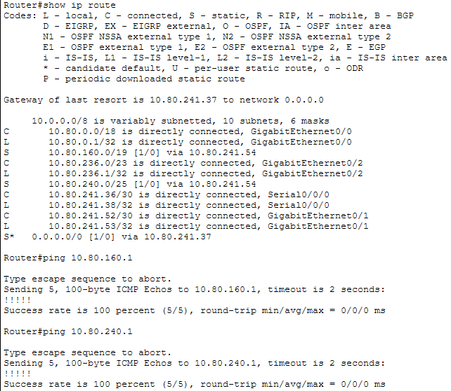

**Penjelasan**: console R-UTARA. `show ip route` memperlihatkan `S 10.80.160.0/19` (SCADA) dan `S 10.80.240.0/25` (Kantor Pelabuhan) via 10.80.241.54 sesuai ketentuan "R-UTARA wajib punya route ke LAN Pelabuhan". Dua ping di bawahnya (10.80.160.1 dan 10.80.240.1) sukses 100% (5/5) — rute ke dalam berfungsi.


**Penjelasan**: Command Prompt SRV-BALAIKOTA (LAN 10.80.241.0/27) ping 10.80.96.1 (gateway CCTV di R-DC) — 4/4 reply, 0% loss, TTL 254. Bukti end-to-end: paket host menyeberangi R-PUSAT → serial → R-DC hanya dengan static route.

## Soal 4 — DHCP
> **Ketentuan:** Perangkat pengguna mendapat alamat, gateway, dan DNS; CCTV Kota dilayani server DHCP di DC.

Dua screenshot klien CCTV yang tersedia menunjukkan alamat lease berbeda pada waktu pengambilan: `DHCP_GET_IP.png` menampilkan `10.80.96.2`, sedangkan `dhcp-cctv-ipconfig.png` menampilkan `10.80.96.3`. Keduanya menampilkan mask `255.255.224.0`, gateway `10.80.96.1`, dan DNS `10.80.239.2`; screenshot kedua juga menampilkan DHCP server `10.80.239.2`. Perbedaan alamat ini konsisten dengan snapshot lease yang berbeda dan tidak membuktikan konflik. Konfigurasi helper, pool/lease server, serta DHCP pada LAN lain belum diverifikasi langsung di Packet Tracer.

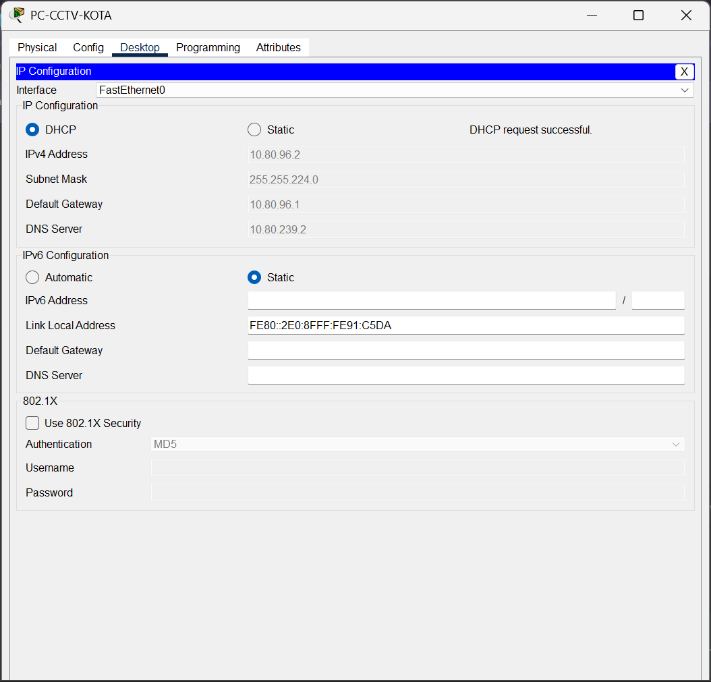

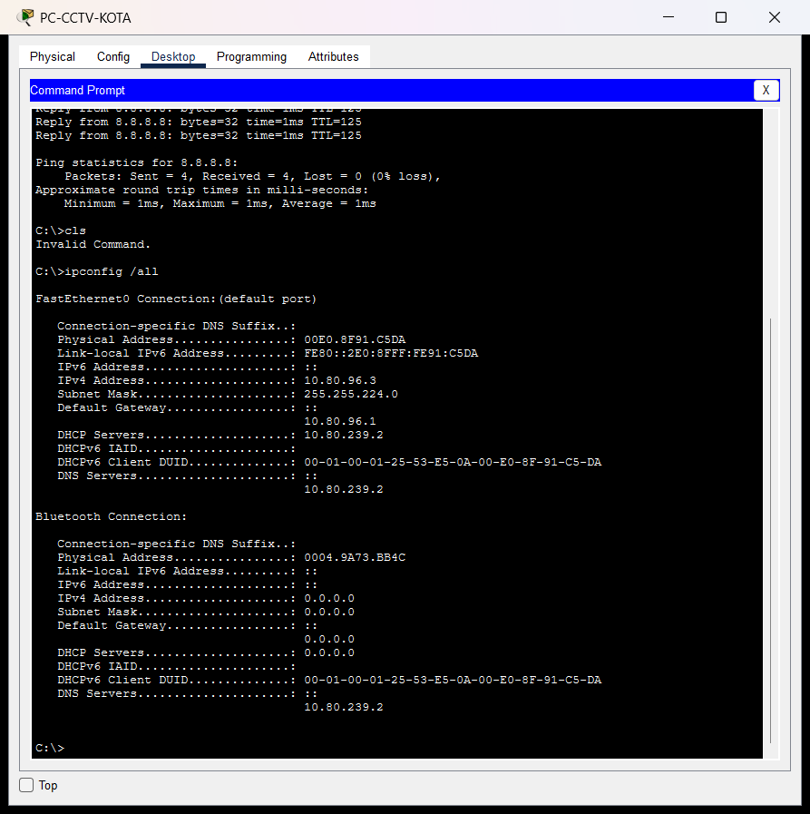

---

## Soal 5 — NAT/PAT

PAT di R-PUSAT: seluruh 10.80.0.0/16 diterjemahkan ke 1 IP publik 203.0.113.42

```cisco
access-list 100 permit ip 10.80.0.0 0.0.255.255 any
ip nat pool PUB 203.0.113.42 203.0.113.42 netmask 255.255.255.252
ip nat inside source list 100 pool PUB overload
! outside : G0/2 (ethernet straight ke R-ISP)
! inside  : G0/0, G0/1, S0/0/1, S0/2/0, S0/2/1, S0/3/0, S0/3/1 (semua link internal)
```

Hasil `show ip nat translations` (setelah ping 8.8.8.8 dari kedua server):

```
Pro  Inside global     Inside local       Outside local   Outside global
icmp 203.0.113.42:18   10.80.239.2:18     8.8.8.8:18      8.8.8.8:18
icmp 203.0.113.42:19   10.80.241.2:19     8.8.8.8:19      8.8.8.8:19
```

Bukti screenshot yang tersedia menunjukkan ping `8.8.8.8` dari kedua server; screenshot server Balai Kota menampilkan satu timeout awal lalu tiga reply, sementara screenshot server DC menunjukkan empat reply. Ini bukti untuk dua host tersebut saja dan bukan verifikasi semua host atau semua wilayah.

.png)

**Penjelasan**: Command Prompt SRV-BALAIKOTA (IP privat `10.80.241.2`) ping `8.8.8.8` — screenshot menampilkan 3/4 reply. Satu timeout awal tampak pada bukti; penyebabnya tidak dapat dipastikan dari screenshot saja.

.png)

**Penjelasan**: hal yang sama dari SRV-DC (IP privat 10.80.239.2, LAN berbeda/router berbeda) — 4/4 reply, 0% loss, TTL 125. Dua host di LAN berbeda sama-sama keluar lewat satu IP publik yang sama.


**Penjelasan**: `show ip nat translations` di R-PUSAT. Terlihat 8 entri icmp: inside local `10.80.239.2` dan `10.80.241.2` diterjemahkan ke inside global yang sama `203.0.113.42` dengan nomor port berbeda (10, 11, 12, …, 24) — bukti PAT overload: banyak host berbagi 1 IP publik, dibedakan lewat port.


**Penjelasan**: `show ip route` di R-ISP hanya memuat jaringan connected (8.8.8.0/24 dan 203.0.113.40/30) — tidak ada satu pun rute ke 10.80.0.0/16, sesuai ketentuan "R-ISP tidak boleh memiliki rute ke alamat privat internal".

## Soal 6 — Tunnel GRE

Screenshot `gre-tunnel-status.png` memperlihatkan `Tunnel0` R-PUSAT berstatus up/up dengan alamat `192.168.10.1/30`; tabel rute yang tampil mengarahkan LAN Pelabuhan melalui next-hop tunnel `192.168.10.2`. Screenshot `gre-tracert.png` menunjukkan traceroute dari host Balai Kota menuju host Pelabuhan melewati hop `192.168.10.2`. Bukti ini mendukung pemilihan tunnel pada jalur yang diuji. Route spesifik ke LAN Pelabuhan melalui tunnel lebih spesifik daripada default route; konfigurasi lengkap kedua ujung tunnel dan jalur aktual tetap perlu diperiksa di Packet Tracer.

GRE mengenkapsulasi paket IP di dalam paket IP untuk membentuk tunnel, tetapi GRE sendiri **tidak mengenkripsi** payload. IPsec merupakan bonus pada brief; status IPsec belum diverifikasi dan tidak diklaim.

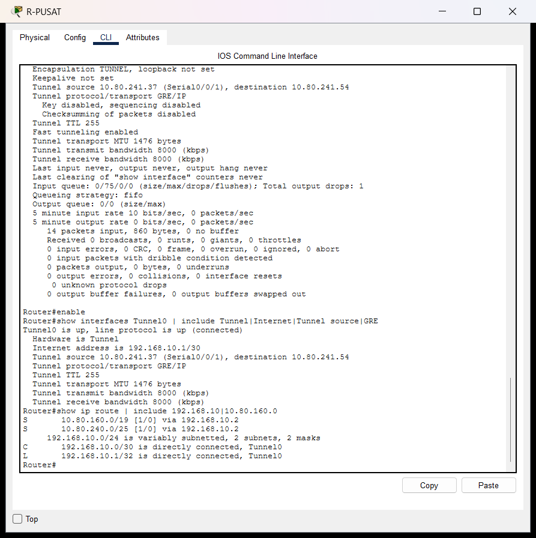

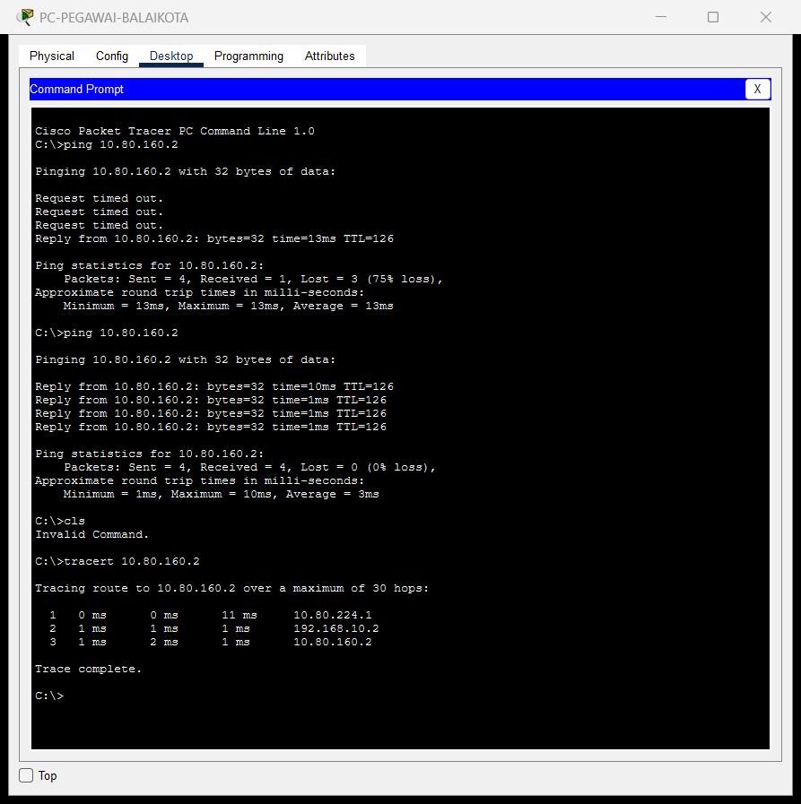

## Soal 7 — OSPF dan failover (file terpisah)

File yang ditujukan untuk bagian ini adalah `K10_VLSM_OSPF.pkt`. Screenshot yang tersedia menunjukkan neighbor OSPF berstatus `FULL` dan route OSPF pada R-UTARA; `ospf-tanpa-static.png` memperlihatkan tidak ada keluaran untuk perintah pencarian static route yang ditampilkan pada router tersebut. Screenshot failover memperlihatkan ping sempat timeout lalu berhasil kembali. Ini adalah bukti snapshot untuk router dan skenario yang terlihat, bukan verifikasi semua router, penyebaran default route, atau seluruh kondisi failover.

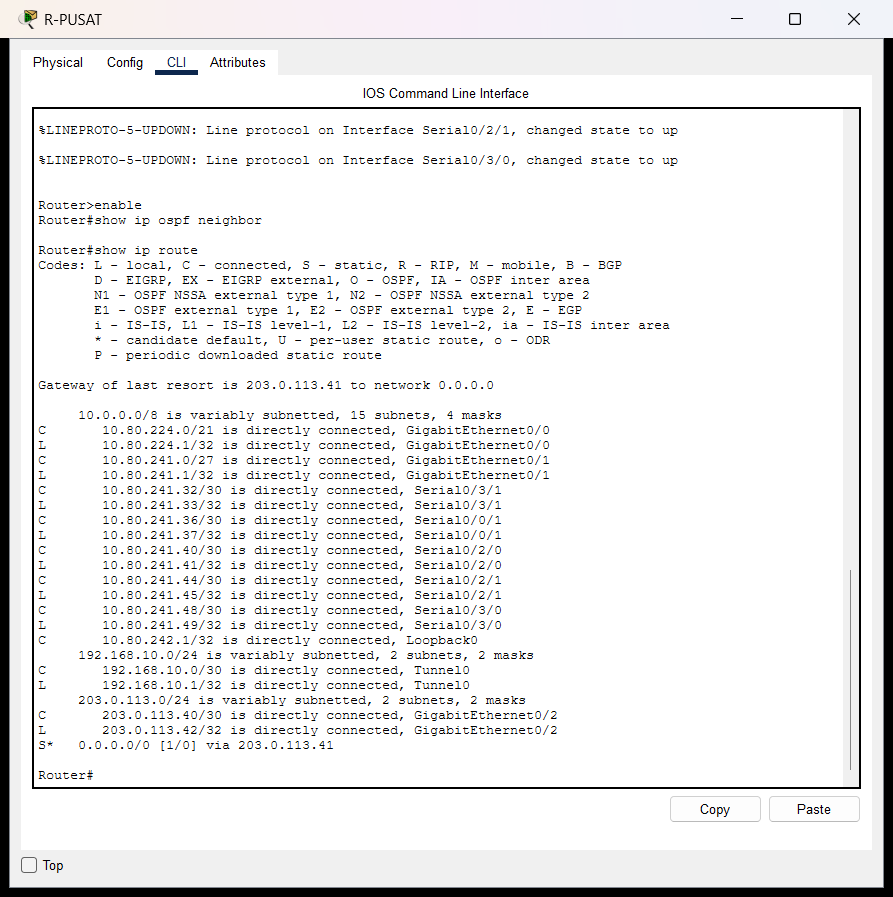

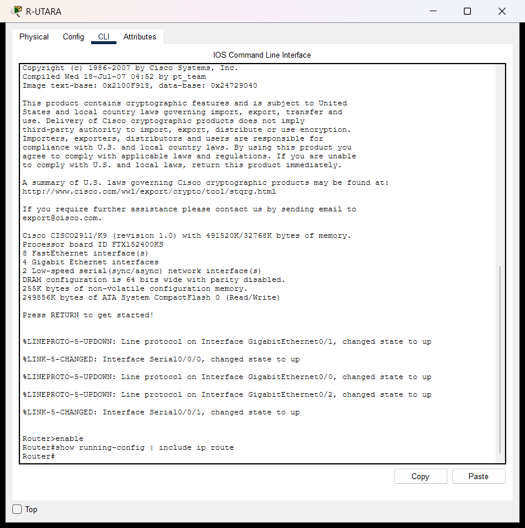

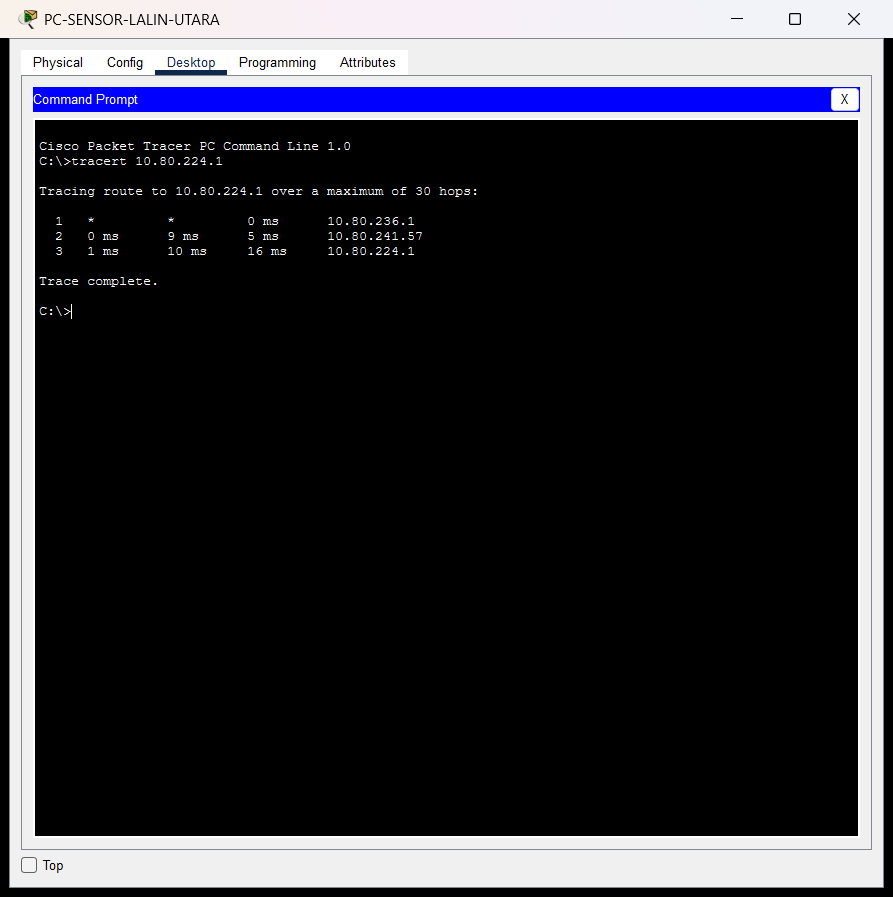

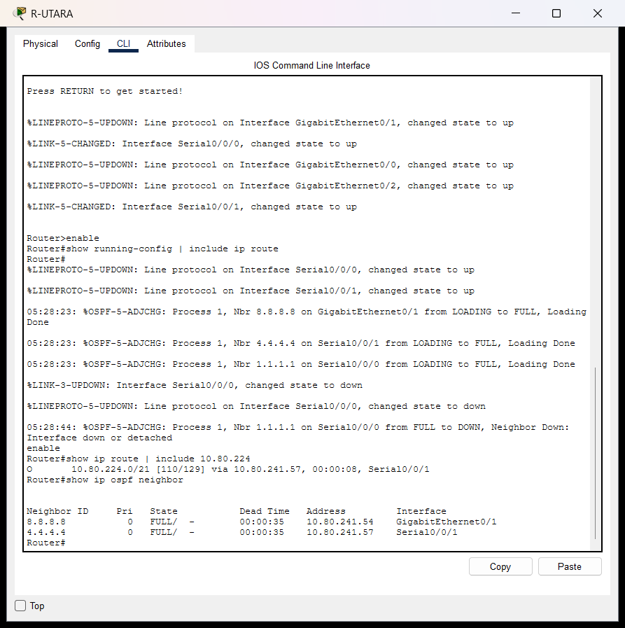


## Soal 8 — Layanan Aplikasi
> **Ketentuan:** DNS, web, FTP, dan email berjalan dari semua wilayah.

### 1. DNS dan Web
Screenshot `DNS_Succes.png` menampilkan halaman portal melalui `http://www.k10.smartcity.lab` dari klien CCTV. Ini mendukung bahwa web dapat dibuka dengan nama tersebut pada pengujian yang ditampilkan. Halaman menampilkan `Smart City Portal` dan Kelompok 10, tetapi bukan judul persis `Portal Smart City Surabaya` yang tertulis di brief. Teks brief yang diberikan juga menggunakan format domain yang perlu dikonfirmasi; nama yang telah terlihat tidak diubah berdasarkan asumsi. Screenshot ini belum membuktikan resolusi DNS atau akses web dari seluruh wilayah.

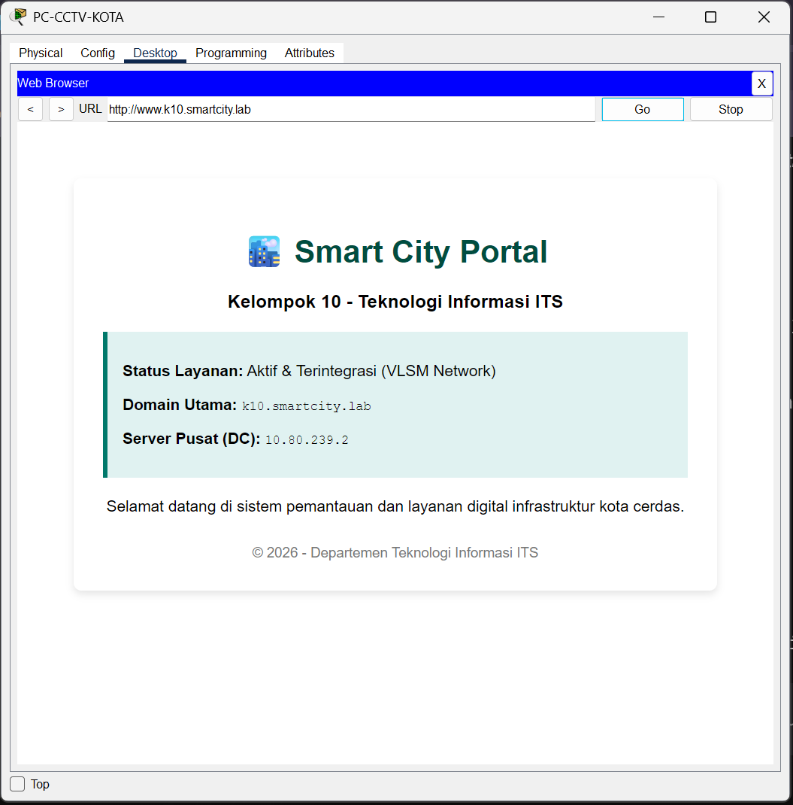

### 2. FTP
Screenshot `Ping_FTP.png` menunjukkan klien CCTV dapat ping ke server DC dan berhasil login ke FTP dengan username yang terlihat pada screenshot. Bukti ini tidak menunjukkan unggah/unduh file, sehingga fungsi unggah rekaman CCTV belum terverifikasi.

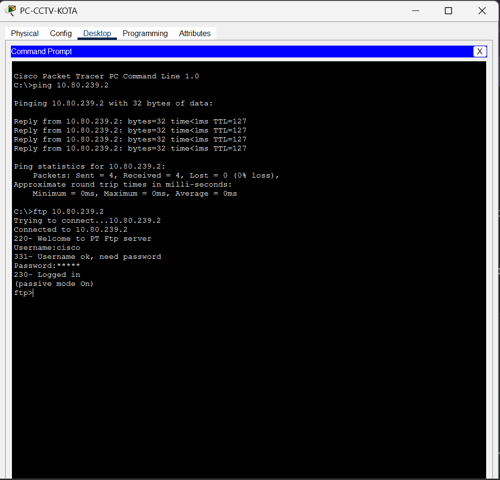

### 3. Email
Screenshot `Email_succes.png` menampilkan kotak masuk pada PC-CCTV-KOTA dengan sebuah pesan dan notifikasi `Delivery Status Notification (Failure)`. Bukti ini tidak membuktikan email berhasil terkirim dan diterima antara pegawai Balai Kota dan Pelabuhan sebagaimana diminta. Pengujian pasangan pengirim/penerima tersebut masih diperlukan.

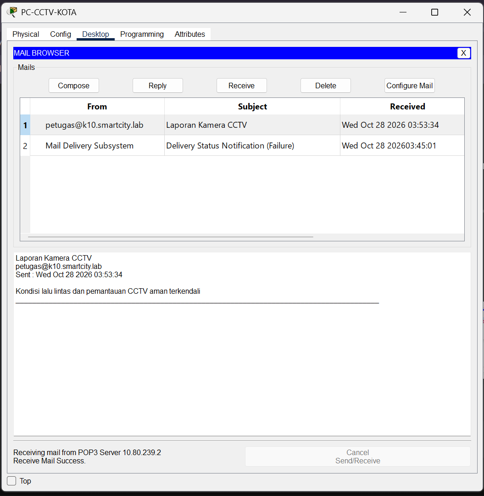

## Audit statis spreadsheet

Pemeriksaan XML `K10_Subnetting.xlsx` menemukan formula pada seluruh tab perhitungan dan tidak menemukan token formula `#REF!` atau `#NAME?`. Pemeriksaan independen atas 20 baris VLSM (14 LAN dan 6 link yang tercatat sebagai input UTS) mendapatkan kecocokan prefix minimum serta Network ID input pada semua baris. Untuk CIDR UTS, 8 dari 20 Network ID tidak sejajar dengan prefix, sesuai peringatan yang dicatat spreadsheet. Pemeriksaan aritmetika atas 20 alokasi CIDR revisi dan 7 supernet tidak menemukan ketidaksejajaran, tumpang tindih, atau subnet di luar supernetnya.

Workbook menyimpan 1.036 formula tanpa nilai hasil ter-cache dan meminta kalkulasi ulang saat dibuka (`fullCalcOnLoad`). Karena itu, hasil tampilan formula masih perlu diperiksa setelah spreadsheet dibuka/dihitung ulang di aplikasi spreadsheet. Tidak ditemukan kesalahan formula yang cukup terbukti untuk diubah; input UTS, asumsi basis `/16`, dan alokasi CIDR revisi `/15` dipertahankan. Tab `Label_Topologi` mengambil kebutuhan host dari data VLSM; perbedaan angka Utara/Barat berada pada screenshot topologi, bukan pada input spreadsheet yang diperiksa.

## Checklist status bukti untuk soal 1–8

Status **Incomplete** berarti ada bukti sebagian, tetapi belum cukup untuk menyatakan seluruh requirement selesai. **Unverified** berarti tidak ada bukti yang cukup untuk memastikan aspek tersebut. Snapshot lama tidak dianggap sebagai pengganti pengujian langsung di file Packet Tracer.

| Soal | Status | Bukti yang tersedia | Yang masih perlu diverifikasi |
|---|---|---|---|
| 1. Topologi | Incomplete | `screenshots/topologi_v2.png`; uraian desain dan port map di README | Cocokkan koneksi dengan Gambar 1, status link pada file, serta seluruh label LAN. Screenshot menunjukkan jumlah host WiFi Utara/Barat yang tidak cocok dengan tab `VLSM`. |
| 2. Tabel subnetting | Incomplete | `K10_Subnetting.xlsx` tab `VLSM`, `CIDR_UTS`, `CIDR_Revisi`, `Supernet`, `Tabel_Revisi`, dan `Alamat_Tambahan` | Cocokkan transkripsi dengan lembar UTS asli dan periksa hasil rumus setelah workbook dihitung ulang di aplikasi spreadsheet. Konfirmasi catatan bahwa CIDR revisi memerlukan `/15`. |
| 3. Static routing | Incomplete | `screenshots/routing+nat.png`, `static-route-utara-pelabuhan.png`, `ping-host-lan-jauh.png`; uraian static route di README | Verifikasi seluruh route wajib dan khususnya default R-PELABUHAN ke R-UTARA. |
| 4. DHCP | Incomplete | `screenshots/DHCP_GET_IP.png`, `dhcp-cctv-ipconfig.png` | Verifikasi helper dan lease di server DC serta DHCP, gateway, dan DNS untuk klien LAN lain. |
| 5. NAT | Incomplete | `SRV-BALAIKOTA(NAT).png`, `SRV-DC(NAT).png`, `translasi-pusat.png`, `isp-tanpa-rute-privat.png` | Uji akses internet dari wilayah lain dan pastikan tidak ada route privat pada R-ISP di file saat ini. |
| 6. GRE | Incomplete | `gre-tunnel-status.png`, `gre-tracert.png` | Verifikasi konfigurasi kedua ujung, jalur dari file saat ini, serta penjelasan; IPsec bonus belum diverifikasi. |
| 7. OSPF | Incomplete | `ospf-neighbor-route.png`, `ospf-tanpa-static.png`, `ospf-failover-l7.png`, `ospf-failover-route.png` | Verifikasi L7, seluruh router, default route yang dipelajari otomatis, serta live failover saat link utama diputus/dipulihkan. |
| 8. Aplikasi | Incomplete | `DNS_Succes.png`, `Ping_FTP.png`, `Email_succes.png` | Konfirmasi domain yang diwajibkan; periksa judul web agar sesuai teks brief; uji DNS/web dari wilayah berbeda, unggah FTP CCTV, dan email berhasil antara Balai Kota dan Pelabuhan. Screenshot email memuat notifikasi kegagalan. |

**Batas audit:** file `.pkt` tidak diubah atau diuji dalam Packet Tracer pada audit ini. Video demo dan ZIP final belum tercatat di inventaris folder saat audit; finalisasi nama ZIP juga menunggu identitas/NRP yang dikonfirmasi.

## Instruksi pemeriksaan manual di Packet Tracer

Langkah berikut belum dijalankan dalam audit ini. Buka salinan kerja, jangan menimpa file utama saat melakukan uji yang memutus link.

1. **Bandingkan file `.pkt`:** buka `K10_VLSM.pkt`, `K10_VLSM_AzhariDone.pkt`, dan `K10_VLSM_OSPF.pkt` satu per satu. Bandingkan nama perangkat, koneksi, status interface, label LAN, dan konfigurasi router. Jangan memilih file final hanya dari ukuran/hash.
2. **Periksa alamat dan route statis:** pada setiap router jalankan `show ip interface brief` dan `show ip route`. Khusus R-PELABUHAN, pastikan default mengarah ke R-UTARA sesuai link L6; pada R-DC pastikan default ke R-PUSAT; pada R-PUSAT pastikan default ke R-ISP. Periksa route wajib R-PUSAT/R-UTARA, serta pastikan tabel R-ISP tidak memuat route privat.
3. **Periksa NAT:** pada R-PUSAT jalankan `show ip nat translations` setelah klien mengakses server internet. Pastikan alamat inside global sama dengan IP publik R-PUSAT yang tercatat di spreadsheet.
4. **Periksa DHCP:** pada PC pengguna dan PC CCTV jalankan `ipconfig /all` (atau gunakan tombol DHCP pada GUI PC). Verifikasi IP, mask, gateway, dan DNS. Pada R-DC periksa `show running-config` untuk helper pada interface CCTV; pada server DC, periksa pool dan lease melalui tab Services. Jangan ubah alamat/pool sebelum mencocokkannya dengan spreadsheet.
5. **Periksa GRE:** pada kedua endpoint jalankan `show interfaces tunnel0` dan `show ip route`; dari PC Balai Kota jalankan `tracert` menuju host di LAN Pelabuhan. Pastikan rute spesifik yang diuji melewati tunnel. Jangan menyimpulkan payload terenkripsi kecuali IPsec benar-benar dikonfigurasi dan SA/paket ESP dapat dibuktikan.
6. **Periksa OSPF:** hanya pada file OSPF, jalankan `show ip ospf neighbor`, `show ip route ospf`, dan `show ip route`. Verifikasi L7, neighbor Full, route OSPF, tidak adanya static route antar-router, interface LAN yang pasif, dan default route yang berasal dari R-PUSAT.
7. **Uji failover:** simpan salinan file OSPF untuk uji; mulai ping kontinu dari LAN yang melewati R-DC/R-UTARA, putuskan link utama dalam salinan, amati route dan pemulihan melalui L7, lalu pulihkan link sebelum menutup salinan. Jangan simpan perubahan uji ke file dasar.
8. **Periksa layanan:** pada server DC periksa DNS records untuk nama `www`, `ftp`, dan `mail` pada domain yang sudah dikonfirmasi, serta layanan FTP dan akun yang memang dikonfigurasi. Pada server Balai Kota periksa web/email. Dari wilayah berbeda, uji DNS dan web dengan nama domain; dari PC CCTV lakukan login dan upload file uji FTP; uji email dua arah antara akun pegawai Balai Kota dan Pelabuhan. Pastikan halaman web memuat teks `Portal Smart City Surabaya` dan nomor kelompok.
