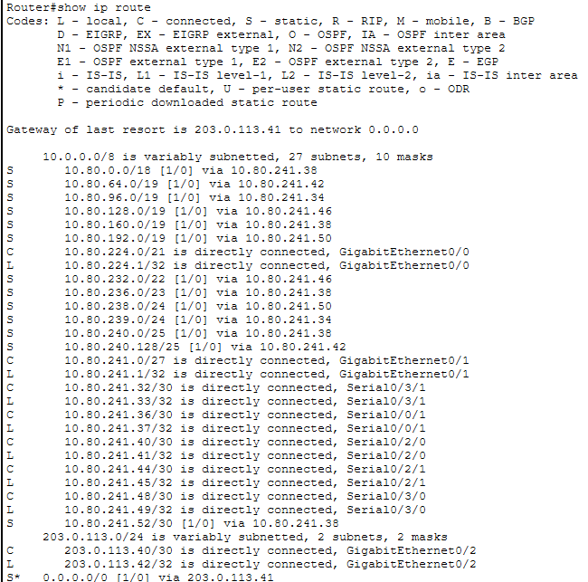
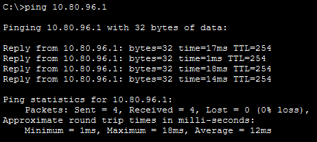
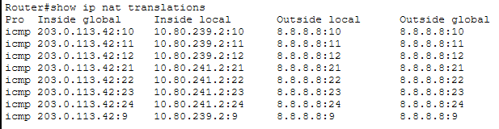
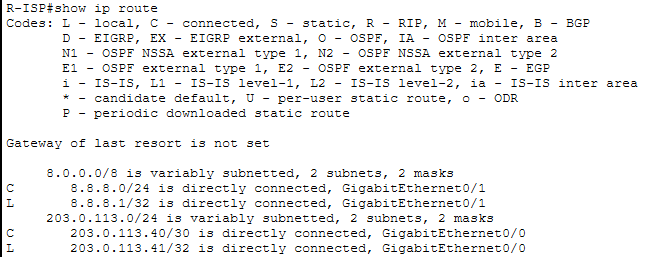

# Mid-Project Jarkom Kelompok 10

## Alasan pemilihan skema: VLSM (bukan CIDR)

Skema utama **VLSM** karena: (1) hasil perhitungan UTS kelompok kami sudah VLSM dan muat penuh di 10.80.0.0/16 tanpa supernet; (2) VLSM mengalokasikan prefix per-kebutuhan host (misal Kantor Pelabuhan 80 host cukup /25, Puskesmas 200 host cukup /24), sehingga paling hemat; (3) alternatif CIDR (pembagian blok /18 merata) memaksa WiFi Barat /19 hanya berkapasitas 8.190 host padahal butuh 11.000, dan versi CIDR murni memerlukan supernet 10.80.0.0/15 di luar blok yang ditentukan soal

## Alasan desain per lokasi

- **Balai Kota (R-PUSAT)**: 2 LAN terpisah (Pegawai /21 dan Server /27) masing-masing satu switch 2960, langsung ke port routed G0/0–G0/1. R-PUSAT memakai 3× HWIC-2T karena 2911 hanya punya 3 port routed bawaan dan butuh 8 koneksi (2 switch LAN + 6 backbone).
- **Data Center (R-DC)**: CCTV Kota (PC perwakilan di SW-CCTV) dan Server&Storage (Server-PT, nanti DNS/FTP/DHCP) di dua switch terpisah.
- **Layanan publik (WiFi Utara/Selatan/Timur/Barat)**: AccessPoint-PT tersambung copper ke router, klien wireless (3 smartphone + 1 laptop) — mewakili akses publik kota.
- **Sensor (Lalin Utara /22, Banjir Timur /22)**: PC perwakilan pada switch.
- **Puskesmas & PJU**: PC perwakilan pada switch.
- **Pelabuhan**: SCADA (PC) dan Kantor (PC) pada dua switch; L6 ke R-UTARA ethernet, backbone ke PUSAT via serial transit R-UTARA.
- **Media backbone**: serial (HWIC-2T) untuk L1–L5 (port routed 2911 terbatas); PUSAT–ISP dan L6 ethernet; LAN memakai straight copper; klien wireless lewat AP.
- **Perwakilan 1 device/LAN** sesuai instruksi; perhitungan subnet tetap memakai jumlah host penuh.

## Soal 1 — Topologi

Topologi mengikuti Gambar 1: 41 perangkat, 43 kabel, semua link up (`pt_health_check` → `healthy=true`, 0 down).

- Semua perangkat bernama deskriptif (R-PUSAT, SW-BALAIKOTA, PC-CCTV-KOTA, dst).
- 14 label LAN pada kanvas format `nama | netid/prefix | jumlah host`.
- Backbone & hubungan antar-router (termasuk R-ISP dan server 8.8.8.8) sesuai Gambar 1.

**Rincian 41 perangkat:** 8 router 2911, 10 switch 2960-24TT, 4 Access Point, 3 server, 8 PC, 4 klien wireless (3 smartphone + 1 laptop), 4 Power Distribution Device (otomatis PT).

**Rincian 43 kabel:** 7 backbone router-router + 14 uplink LAN (10 switch + 4 AP) + 11 kabel host (8 PC + 3 server) + 4 asosiasi wireless + 7 kabel power PDU.


**Penjelasan**: screenshot kanvas logical Packet Tracer. Terlihat 8 router (nama deskriptif), 14 LAN dengan label `nama | Network ID/prefix | jumlah host`, 4 AP dengan klien wireless-nya, R-ISP yang menghubungkan R-PUSAT ke server internet 8.8.8.8, serta backbone serial (garis petir, L1–L5) dan ethernet (L6, PUSAT–ISP, LAN).

### Port map R-PUSAT (2911 + 3× HWIC-2T)
| Port | Arah | Peran |
|---|---|---|
| G0/0 | SW-BALAIKOTA | LAN Pegawai Balai Kota (10.80.224.1/21) |
| G0/1 | SW-SERVER-BALAIKOTA | LAN Server Balai Kota (10.80.241.1/27) |
| G0/2 | R-ISP | **ethernet straight** 203.0.113.42/30 (**outside NAT**) |
| S0/0/1 | R-UTARA | serial 10.80.241.37/30 (L2) |
| S0/2/0 | R-SELATAN | serial 10.80.241.41/30 (L3) |
| S0/2/1 | R-TIMUR | serial 10.80.241.45/30 (L4) |
| S0/3/0 | R-BARAT | serial 10.80.241.49/30 (L5) |
| S0/3/1 | R-DC | serial 10.80.241.33/30 (L1) |

Sisi DCE semua serial ada di R-PUSAT, `clock rate 2000000`.

### Port map R-UTARA
S0/0/0 → R-PUSAT (10.80.241.38/30); G0/0 → AP WiFi Utara (10.80.0.1/18); G0/1 → R-PELABUHAN (10.80.241.53/30, L6); G0/2 → SW-SENSOR-UTARA (10.80.236.1/23).

Router lain: R-DC S0/0/0 = backbone ke R-PUSAT, G0/1 & G0/2 = LAN-nya; SELATAN/TIMUR/BARAT sama pola (S0/0/0 backbone). R-ISP: G0/0 = 203.0.113.41/30 (straight ke PUSAT), G0/1 = 8.8.8.1/24.

## Soal 2 — DHCP
> **Ketentuan:** Perangkat pengguna mendapat alamat, gateway, dan DNS; CCTV Kota dilayani server DHCP di DC.

Perangkat klien `PC-CCTV-KOTA` berhasil meminta dan menerima konfigurasi pengalamatan IP otomatis, Gateway, serta DNS langsung dari server pusat di Data Center (`SRV-DC`) menggunakan mekanisme *DHCP Relay* (`ip helper-address 10.80.239.2`) pada router `R-DC`.
* **Hasil Terkonfigurasi:**
  * **IPv4 Address:** `10.80.96.2`
  * **Subnet Mask:** `255.255.224.0`
  * **Default Gateway:** `10.80.96.1`
  * **DNS Server:** `10.80.239.2`


---

## Soal 3 — Pengalamatan + Static/Default Routing

Skema utama **VLSM** (hasil UTS), gateway = host pertama tiap subnet. Setiap LAN satu subnet, gateway di port routed router.

### Tabel pengalamatan
| Lokasi | Subnet | Gateway (IP router) |
|---|---|---|
| WiFi Utara | 10.80.0.0/18 | 10.80.0.1 (R-UTARA G0/0) |
| WiFi Selatan | 10.80.64.0/19 | 10.80.64.1 (R-SELATAN G0/1) |
| CCTV Kota | 10.80.96.0/19 | 10.80.96.1 (R-DC G0/1) |
| WiFi Timur | 10.80.128.0/19 | 10.80.128.1 (R-TIMUR G0/1) |
| SCADA Pelabuhan | 10.80.160.0/19 | 10.80.160.1 (R-PELABUHAN G0/1) |
| WiFi Barat | 10.80.192.0/19 | 10.80.192.1 (R-BARAT G0/1) |
| Pegawai Balai Kota | 10.80.224.0/21 | 10.80.224.1 (R-PUSAT G0/0) |
| Sensor Banjir Timur | 10.80.232.0/22 | 10.80.232.1 (R-TIMUR G0/2) |
| Sensor Lalin Utara | 10.80.236.0/23 | 10.80.236.1 (R-UTARA G0/2) |
| Puskesmas | 10.80.238.0/24 | 10.80.238.1 (R-BARAT G0/2) |
| Server DC | 10.80.239.0/24 | 10.80.239.1 (R-DC G0/2) |
| Kantor Pelabuhan | 10.80.240.0/25 | 10.80.240.1 (R-PELABUHAN G0/2) |
| PJU Selatan | 10.80.240.128/25 | 10.80.240.129 (R-SELATAN G0/2) |
| Server Balai Kota | 10.80.241.0/27 | 10.80.241.1 (R-PUSAT G0/1) |

### Link /30
| Link | Subnet | Media | Ujung A | Ujung B |
|---|---|---|---|---|
| L1 PUSAT–DC | 10.80.241.32/30 | serial | .33 | .34 |
| L2 PUSAT–UTARA | 10.80.241.36/30 | serial | .37 | .38 |
| L3 PUSAT–SELATAN | 10.80.241.40/30 | serial | .41 | .42 |
| L4 PUSAT–TIMUR | 10.80.241.44/30 | serial | .45 | .46 |
| L5 PUSAT–BARAT | 10.80.241.48/30 | serial | .49 | .50 |
| L6 UTARA–PELABUHAN | 10.80.241.52/30 | ethernet | .53 | .54 |
| PUSAT–ISP | 203.0.113.40/30 | straight | .42 (PUSAT) | .41 (ISP) |
| ISP–Internet | 8.8.8.0/24 | ethernet | .1 (ISP G0/1) | .8.8.8 (server) |

Server statis: SRV-BALAIKOTA 10.80.241.2/27, SRV-DC 10.80.239.2/24, SRV-INTERNET 8.8.8.8/24 (gw 8.8.8.1).

### Rute statis
- **R-PUSAT**: default → 203.0.113.41; route ke semua LAN cabang via next-hop L1–L5; route 10.80.241.52/30 & LAN Pelabuhan (transit) via 10.80.241.38.
- **Router cabang (DC, UTARA, TIMUR, SELATAN, BARAT, PELABUHAN)**: default → R-PUSAT; **R-UTARA** tambahan route 10.80.160.0/19 & 10.80.240.0/25 via 10.80.241.54.
- **R-ISP**: tanpa rute ke jaringan privat (hanya connected) — khas ISP.

```cisco
R-PUSAT
ip route 0.0.0.0 0.0.0.0 203.0.113.41
ip route 10.80.96.0 255.255.224.0 10.80.241.34
ip route 10.80.239.0 255.255.255.0 10.80.241.34
ip route 10.80.0.0 255.255.192.0 10.80.241.38
ip route 10.80.236.0 255.255.254.0 10.80.241.38
ip route 10.80.241.52 255.255.255.252 10.80.241.38
ip route 10.80.160.0 255.255.224.0 10.80.241.38
ip route 10.80.240.0 255.255.255.128 10.80.241.38
ip route 10.80.64.0 255.255.224.0 10.80.241.42
ip route 10.80.240.128 255.255.255.128 10.80.241.42
ip route 10.80.128.0 255.255.224.0 10.80.241.46
ip route 10.80.232.0 255.255.252.0 10.80.241.46
ip route 10.80.192.0 255.255.224.0 10.80.241.50
ip route 10.80.238.0 255.255.255.0 10.80.241.50
```

### Hasil uji (ping, 18/18 sukses)
R-PUSAT → 12 gateway LAN cabang 100%; antar-cabang (BARAT↔TIMUR, DC↔PUSAT, SELATAN→UTARA, UTARA→PELABUHAN, PELABUHAN→PUSAT) 100%; host → LAN jauh (SRV-BALAIKOTA → 10.80.96.1, TTL 254).



**Penjelasan**: console R-PUSAT menampilkan `show ip route` — 13 static route `S` (12 ke LAN cabang + 1 transit `10.80.241.52/30`, next-hop via serial L1–L5) dan `S* 0.0.0.0/0 via 203.0.113.41` (default ke R-ISP). Baris `C`/`L` adalah subnet connected + local route /32 otomatis IOS.


**Penjelasan**: console R-UTARA. `show ip route` memperlihatkan `S 10.80.160.0/19` (SCADA) dan `S 10.80.240.0/25` (Kantor Pelabuhan) via 10.80.241.54 sesuai ketentuan "R-UTARA wajib punya route ke LAN Pelabuhan". Dua ping di bawahnya (10.80.160.1 dan 10.80.240.1) sukses 100% (5/5) — rute ke dalam berfungsi.



**Penjelasan**: Command Prompt SRV-BALAIKOTA (LAN 10.80.241.0/27) ping 10.80.96.1 (gateway CCTV di R-DC) — 4/4 reply, 0% loss, TTL 254. Bukti end-to-end: paket host menyeberangi R-PUSAT → serial → R-DC hanya dengan static route.

## Soal 5 — NAT/PAT

PAT di R-PUSAT: seluruh 10.80.0.0/16 diterjemahkan ke 1 IP publik 203.0.113.42

```cisco
access-list 100 permit ip 10.80.0.0 0.0.255.255 any
ip nat pool PUB 203.0.113.42 203.0.113.42 netmask 255.255.255.252
ip nat inside source list 100 pool PUB overload
! outside : G0/2 (ethernet straight ke R-ISP)
! inside  : G0/0, G0/1, S0/0/1, S0/2/0, S0/2/1, S0/3/0, S0/3/1 (semua link internal)
```

Hasil `show ip nat translations` (setelah ping 8.8.8.8 dari kedua server):

```
Pro  Inside global     Inside local       Outside local   Outside global
icmp 203.0.113.42:18   10.80.239.2:18     8.8.8.8:18      8.8.8.8:18
icmp 203.0.113.42:19   10.80.241.2:19     8.8.8.8:19      8.8.8.8:19
```

Uji: SRV-BALAIKOTA & SRV-DC ping 8.8.8.8 → 4/4 received (0% loss) masing-masing. Catatan: R-ISP tetap tanpa rute privat — bukti NAT bekerja.

.png)

**Penjelasan**: Command Prompt SRV-BALAIKOTA (IP privat 10.80.241.2) ping 8.8.8.8 — 3/4 reply. Reply datang padahal R-ISP tidak tahu jaringan privat: bukti sumber paket sudah diterjemahkan menjadi 203.0.113.42 oleh PAT di R-PUSAT. Satu `Request timed out` di ping pertama adalah ARP/term warm-up yang normal di Packet Tracer; ping berikutnya 100%.

.png)

**Penjelasan**: hal yang sama dari SRV-DC (IP privat 10.80.239.2, LAN berbeda/router berbeda) — 4/4 reply, 0% loss, TTL 125. Dua host di LAN berbeda sama-sama keluar lewat satu IP publik yang sama.



**Penjelasan**: `show ip nat translations` di R-PUSAT. Terlihat 8 entri icmp: inside local `10.80.239.2` dan `10.80.241.2` diterjemahkan ke inside global yang sama `203.0.113.42` dengan nomor port berbeda (10, 11, 12, …, 24) — bukti PAT overload: banyak host berbagi 1 IP publik, dibedakan lewat port.



**Penjelasan**: `show ip route` di R-ISP hanya memuat jaringan connected (8.8.8.0/24 dan 203.0.113.40/30) — tidak ada satu pun rute ke 10.80.0.0/16, sesuai ketentuan "R-ISP tidak boleh memiliki rute ke alamat privat internal".


## Soal 8 — Layanan Aplikasi
> **Ketentuan:** DNS, web, FTP, dan email berjalan dari semua wilayah.

### 1. Konektivitas Lintas Subnet (Ping) & Layanan FTP
Uji coba *Ping* dari `PC-CCTV-KOTA` ke server pusat DC berjalan lancar dengan *0% packet loss*. Sesi login ke layanan *File Transfer Protocol* (FTP) menggunakan akun `cisco` juga berhasil terhubung dengan status *Logged in*.
* **Perintah Uji:** `ping 10.80.239.2` & `ftp 10.80.239.2`


### 2. Layanan DNS & Web Server (HTTP)
Akses penjelajahan web dari klien berhasil memetakan domain lokal `http://www.k10.smartcity.lab` melalui layanan DNS menuju ke server web, menampilkan halaman portal utama Smart City Kelompok 10.
* **URL Akses:** `http://www.k10.smartcity.lab`


### 3. Layanan Email (SMTP & POP3)
Layanan komunikasi surat elektronik (*Mail Server*) antar pengguna dalam domain lokal `k10.smartcity.lab` berhasil diuji. Pesan laporan pemantauan dari akun petugas (`petugas@k10.smartcity.lab`) sukses dikirim dan diterima kembali di kotak masuk akun admin (`admin@k10.smartcity.lab`).
* **Status Log:** `Receive Mail Success`


